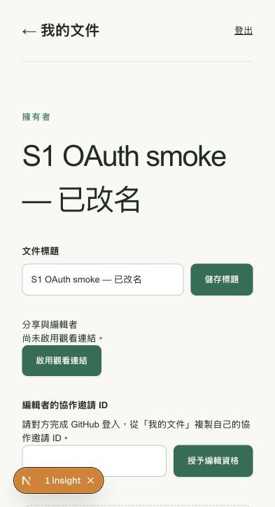
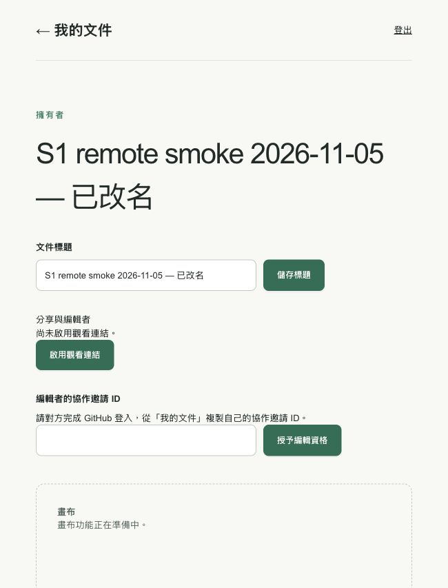
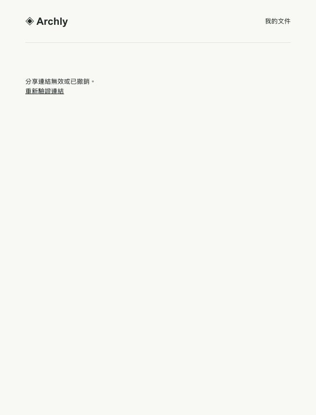

# S1 真實 OAuth 與部署驗收

本文件補上 #3／#4 最後的設定與驗收路徑。**設定引導、preflight、真實 OAuth smoke 是三種不同證據**；全部必要驗收通過前，維持 PR draft 與票券未結案。

## 本機 GitHub OAuth

本機 Apple container 的 Auth 沒有可用於修改 provider 的託管 dashboard；設定由啟動腳本傳入 GoTrue。

1. 在 [GitHub OAuth Apps](https://github.com/settings/applications/new) 建立本機專用 App：Homepage `http://127.0.0.1:3000`；Authorization callback `http://127.0.0.1:54321/auth/v1/callback`。這是 **Supabase Auth callback**，不是 Next.js 的 `/auth/callback`。不啟用 Device Flow。
2. 用本輪互動引導保存 Client ID／新產生的 Client secret；或自行建立 Git 忽略的 `.local-supabase/github-oauth.env`，權限設為 `0600`：

   ```dotenv
   GITHUB_CLIENT_ID='your-client-id'
   GITHUB_CLIENT_SECRET='your-client-secret'
   ```

   secret 只交給本機 GoTrue，不放進 `NEXT_PUBLIC_*`、聊天、提交或 GitHub Actions。
3. 執行 `node scripts/local-supabase.mjs up`，再執行 `pnpm db:migrate:local`。`up` 重新建立無狀態服務並保留 DB 資料卷；已登入使用者會受到短暫服務中斷。設定檔不存在時 provider 預設關閉；不完整、格式錯誤或非私密權限的檔案會在重啟服務前被拒絕。
4. `.env.local` 只需要 `NEXT_PUBLIC_SUPABASE_URL=http://127.0.0.1:54321` 與本機 `NEXT_PUBLIC_SUPABASE_ANON_KEY`，從已忽略的 `app.env` 取得；不要複製 service-role key。保留既有其他設定。此輪已準備這兩個公開值，檔案權限 `0600`。
5. 執行 `pnpm dev`，固定使用 `http://127.0.0.1:3000`。若 port 3000 已占用，先停止既有 server；改 port 必須同步精確的 Auth redirect allow-list。
6. 執行設定檢查：

   ```sh
   node scripts/s1-preflight.mjs http://127.0.0.1:3000 http://127.0.0.1:54321
   ```

   此工具檢查首頁、匿名文件清單的 401、取消登入的重試返回、PKCE／產品返回網址及 GitHub 的 Auth callback。它停在 GitHub 授權頁前，不輸入登入資料、不交換 code、不建立文件；不能驗證 client secret 是否有效、真實 session 或完整產品行為。輸出不包含 OAuth URL、state、code 或 cookie。

## 全新 Supabase／Vercel 專案

本輪只準備引導，沒有建立、購買或部署遠端服務。遠端不能使用本機 `127.0.0.1` Supabase；不要將本機 service-role／JWT secret 複製到託管專案。

1. 在 [Supabase Dashboard](https://supabase.com/dashboard) 建立專用專案。由 Connect 或 Settings → API Keys 取得 project URL 與公開 publishable／legacy anon key；資料庫密碼保留於密碼管理器。
2. 建立遠端專用 GitHub OAuth App，callback 為 `https://<project-ref>.supabase.co/auth/v1/callback`。在 Authentication → Sign In / Providers → GitHub 啟用 provider，直接填入 Client ID／secret 並儲存。
3. **僅對全新且未套用 S1 的專案**，在 SQL Editor 依序一次套用 `supabase/migrations/` 的六個 SQL 檔，整批包在同一個 transaction。此輪已準備本機 bundle `.local-supabase/s1-initial-migrations.sql`，供引導使用。SQL 錯誤即停止；既有資料庫先交由 agent 檢查 migration 狀態，不能重跑 bundle 或刪除資料重來。本機 migration runner 刻意不支援遠端。
4. 依 `CONTEXT.md` 確認適用的 tldraw 授權，再到 [Vercel New Project](https://vercel.com/new) 匯入 `gracecheng0329/editor`。Framework 為 Next.js，root 為 repo 根目錄，build command 使用 `pnpm exec next build --webpack`。設定部署環境（至少 Preview）的兩個公開變數：

   ```text
   NEXT_PUBLIC_SUPABASE_URL=https://<project-ref>.supabase.co
   NEXT_PUBLIC_SUPABASE_ANON_KEY=<publishable-or-anon-key>
   ```

   Next.js 不需要 GitHub client secret 或 Supabase service-role key。公開變數在 build 時固定；變更後要重新部署。
5. 部署已合併 S1 的 `main`，核對部署 commit 包含 S1 實作。2026-11-05 首次遠端驗收版本為 `2ed6f062f9262d7b9c15802075c81564c27b63b5`。驗收時固定產品 origin 並記錄對應 deployment，避免測試中 alias 指向另一提交。若 Vercel Deployment Protection 阻擋匿名工具，記錄為未驗證，改由已授權 browser contexts 驗收；不要將保護頁誤判為產品成功。
6. 在 Supabase Authentication → URL Configuration 設定 Site URL 為固定產品 origin；Redirect URLs 加入精確的 `https://<app-origin>/auth/callback`。這是 **產品 callback**；GitHub 的 Supabase callback 保持不變。遠端 OAuth App 的 Homepage 更新為產品 origin。
7. 將部署 origin 與 Supabase origin 交給 agent，執行 `node scripts/s1-preflight.mjs https://<app-origin> https://<project-ref>.supabase.co`，再執行下列真實 smoke。

## 真實 browser smoke 與完成判準

使用兩個獨立 browser contexts／真實 GitHub 帳號 A、B，及一個匿名 context C。使用者自行完成 GitHub 密碼、2FA 或 consent；不匯出 storage state、cookie、provider token 或錄製登入憑證。

1. A 從產品入口登入，實際經 GitHub → Supabase → 產品 callback 返回「我的文件」。建立、列出、重新開啟、改名並重載，確認保存。
2. B 獨立 GitHub 登入；邀請前不能讀取 A 的私密文件。B 複製協作邀請 ID，A 授予 editor，B 可從自己的清單開啟並看到編輯者身分，不能管理標題／分享／邀請。
3. A 產生分享連結，C 以 viewer 唯讀身分讀到最小中繼資料。輪替後舊連結拒絕；撤銷後新請求拒絕，但 A 與未撤銷 editor 的身分存取仍有效。
4. A 撤銷 B，B 的後續文件讀取被拒；另持有效分享 token 時只能降為 viewer。
5. A 登出，後續私密 API 為 401、重新開啟文件要求登入。舊 JWT 直接 API／RPC 的失效已由本機回歸測試覆蓋；若需遠端重送驗證，由 agent 使用暫存記憶體處理，不能把 cookie 或 token 貼到聊天／文件。

證據記錄日期、部署 commit／origin、各角色步驟與實際結果。全部通過後才能更新 #3／#4 驗收與 PR ready 狀態；畫布內容與既有 WebSocket 撤權仍由 S2 驗收。

## 工具回歸與證據限制

```sh
node --test scripts/test-local-github-oauth.mjs scripts/test-s1-preflight.mjs
```

這些測試使用私密暫存檔與隔離 HTTP fixture，驗證設定載入、憑證拒絕、PKCE／callback 檢查、錯誤 provider 與錯誤匿名授權的偵測。不是外部 GitHub OAuth 或 Vercel 成功證據；不宣稱每一項都有失敗先行紀錄。

2026-11-03：使用者已透過私密引導設定本機 OAuth App，Auth 重啟與七項服務健康檢查成功，五項真實本機 preflight 通過；瀏覽器已到達 GitHub 真實登入頁。原有 S1 回歸 **12 passed（29.0s）**，新增三項工具測試與全專案 lint 通過。preflight 的無效 JSON 保密回歸先實際失敗（錯誤包含 fixture 回應片段），轉成受控錯誤後同一測試通過。首輪 S1 測試曾被 Next 啟動提醒中止，連線拒絕不列為產品 red；重跑後取得上述通過結果。本輪未修改應用程式或 SQL，沒有重跑 production build。本機真實登入後的結果見下節；遠端部署 smoke 尚未執行。

## 本機真實 OAuth smoke 結果（2026-11-03）

使用者自行完成 GitHub 登入／授權後，伺服器確認建立真實 GitHub 身分與有效 Auth session，產品 `/documents` 回應 200。接著由 agent 在 Codex 內建瀏覽器以原登入身分完成，沒有匯出或重建 session：

| 操作 | 實際結果 |
| --- | --- |
| 建立文件 | 建立 `S1 OAuth smoke 2026-11-03`，清單出現可開啟的文件 |
| 重新開啟 | 從清單開啟，顯示擁有者身分及原標題 |
| 改名並保存 | 改為 `S1 OAuth smoke — 已改名`，顯示「標題已儲存」 |
| 重新載入 | 真正 reload 後仍顯示新標題，非僅保留表單狀態 |
| 登出與重開原文件 | 登出返回首頁；重新造訪原文件顯示「請先登入」，不顯示文件標題或存取設定 |



此輪驗證程式基準為 `7fd9ff8`，origin 為 `http://127.0.0.1:3000`，Supabase 為 `http://127.0.0.1:54321`。測試文件保留在本機私密清單，未啟用分享。畫面只含測試標題，沒有憑證或個人資料。

這已完成單一真實 GitHub 帳號的本機登入／文件／登出 smoke。第二個真實 GitHub 帳號的邀請旅程、遠端 OAuth／部署 smoke 尚未執行；先前的獨立測試身分與角色矩陣回歸不改標為真實多帳號 OAuth 證據。#3／#4 與 PR 維持未結案／draft。

官方依據：[GoTrue 自架設定](https://supabase.com/docs/guides/self-hosting/auth/config)、[GitHub provider 設定](https://supabase.com/docs/guides/auth/social-sign-in/auth-github)、[Vercel Git 部署](https://vercel.com/docs/git)。Next.js 環境變數與部署行為另已對照本機安裝版本的 `node_modules/next/dist/docs/`。

## 遠端 smoke 首輪（2026-11-05）

使用者提供部署 origin `https://editor-one-topaz.vercel.app`；實際登入跳轉確認其 Auth origin 為 `https://gnmaayjhlnrlqcpxkjjw.supabase.co`，與 Dashboard 的 `editor-s1-test` 專案一致。部署 commit 尚未核對，不能以本機 HEAD 代替部署版本。

執行 `node scripts/s1-preflight.mjs https://editor-one-topaz.vercel.app https://gnmaayjhlnrlqcpxkjjw.supabase.co`：首頁、匿名文件清單拒絕、取消 OAuth 可重試及 PKCE／產品 callback 四項檢查通過後，在 GitHub provider redirect 檢查失敗（exit 1）。瀏覽器另確認遠端首頁正常顯示產品內容。

對實際登入跳轉進行受控診斷：產品 `/auth/login` 回傳 307，導向預期 Supabase `/auth/v1/authorize`；Auth 回傳 HTTP 400、`error_code=validation_failed`、`Unsupported provider: provider is not enabled`。Dashboard 亦顯示 GitHub DISABLED，Client ID／Client Secret 尚未設定。未記錄 OAuth state、cookie、token 或 secret。

本輪停在遠端 GitHub provider 設定：需使用者建立遠端 OAuth App（callback 為 `https://gnmaayjhlnrlqcpxkjjw.supabase.co/auth/v1/callback`），直接在 Supabase 設定 Client ID／Client Secret 並啟用 GitHub。完成後重跑相同 preflight，再執行真實登入及文件／分享／撤權 smoke。登入後操作、遠端 migration／授權行為與部署 commit 尚未驗證；不宣稱遠端 smoke 或 #4 已完成。

### Provider 啟用後複驗

使用者確認 provider 已啟用後，相同遠端 preflight **5 項 PASS**。首次真實 OAuth 返回另一個部署 alias 的首頁，未完成產品 callback；Dashboard 確認 allow list 缺少本次驗收 origin。經使用者明確批准，新增精確的 `https://editor-one-topaz.vercel.app/auth/callback`，保留既有 Site URL 與其餘 allow list，Dashboard 顯示新增成功。再次由產品入口進行 GitHub OAuth，成功返回原 origin 的 `/documents`，顯示已登入文件入口及協作邀請 ID；沒有匯出 session 或保存 OAuth code。

接著嘗試建立 `S1 remote smoke 2026-11-05`，正式頁面顯示「建立失敗，請再試一次」。以 Dashboard SQL Editor 執行唯讀 `to_regclass` 查詢，`public.documents`、`private.document_shares`、`private.document_editors` 均為 NULL，確認遠端尚缺 S1 資料表。六份 migrations 的一次性 transaction bundle 已準備，待取得使用者的資料庫授權變更確認後套用。此時文件保存、分享／撤權仍未通過。

### Migration 套用與單帳號遠端 smoke 完成（2026-11-05）

使用者明確確認後，在 `editor-s1-test` 的 Dashboard SQL Editor 一次執行六份 S1 migrations（001–006），包在同一筆 `begin`／`commit` transaction。貼入內容經移除註解及空白後與本機已驗證 bundle 的長度及指紋一致，另以 editor 全選複製確認完整內容未截斷；執行結果為 `Success. No rows returned.`。此為 Dashboard 手動套用紀錄，不表示 Supabase CLI migration history 已同步；後續 migration 前先核對資料庫狀態，不重跑初始 bundle。

收尾唯讀查詢確認三個目標表皆已存在，`public.documents.relrowsecurity = true`。SQL Editor 已換成唯讀驗證查詢，避免誤重跑初始 bundle。套用後再次執行相同遠端 preflight，**5 項 PASS、exit 0**。

部署證據：Vercel Project Overview 顯示 `editor-one-topaz.vercel.app` 對應 Ready deployment [`FrfjcnzevPj8HL8MSBqNwxLqVfpw`](https://vercel.com/gracecheng0329s-projects/editor/FrfjcnzevPj8HL8MSBqNwxLqVfpw)，來源為 `main` commit `2ed6f062f9262d7b9c15802075c81564c27b63b5`，部署 hostname 為 `editor-nosmjfk0g-gracecheng0329s-projects.vercel.app`。以下操作均使用使用者指定的產品 origin `https://editor-one-topaz.vercel.app`，Auth origin 為 `https://gnmaayjhlnrlqcpxkjjw.supabase.co`。

| 情境 | 實際結果 |
| --- | --- |
| 真實 GitHub OAuth | 返回原產品 `/documents` 並取得有效登入；後續再次登入同一帳號亦成功，未匯出或重建 session |
| 建立、列出及開啟文件 | migration 前建立失敗，套用後同一旅程成功；文件清單出現測試文件，開啟顯示擁有者 |
| 改名及重新載入 | 改為 `S1 remote smoke 2026-11-05 — 已改名`，顯示保存成功，真正 reload 後仍保留 |
| 分享輪替 | 由 UI 產生兩次觀看連結，兩份連結不同；登出後開啟舊連結顯示「分享連結無效或已撤銷。」 |
| 匿名觀看 | 登出後載入新連結，顯示正確標題與「觀看者・唯讀」，無標題／權限管理操作 |
| 分享撤銷 | 重新以 owner 登入並撤銷，顯示尚未啟用；owner reload 仍可開啟文件 |
| 撤銷後匿名存取 | 再次登出，載入剛撤銷的連結顯示「分享連結無效或已撤銷。」且無文件標題 |
| 登出後私密存取 | 登出後直接重開原文件顯示「請先登入。」；匿名私密 API 的 401 另由 preflight 覆蓋 |

匿名情境使用同一瀏覽器完成產品登出後實測，沒有持有產品登入資格；本次並非多個獨立 browser contexts 同時操作。測試文件保留在遠端 owner 私密清單，分享已撤銷，未新增 editor。完整分享 token 只在操作記憶體使用，不寫入本紀錄；截圖僅含測試內容。





本輪完成單一真實帳號的遠端登入／文件／匿名分享／輪替／撤銷／登出 smoke。第二個真實 GitHub 帳號的 editor 邀請、禁止管理、撤權與持連結降為 viewer，仍因缺少第二帳號而未驗證；本機獨立測試身分的既有結果不能替代它。因此 #4 保持開啟。畫布與既有連線撤權仍屬後續切片。本輪未修改產品程式，不重跑本機產品測試、lint、型別或 build，亦不將它們改記為本輪通過。
