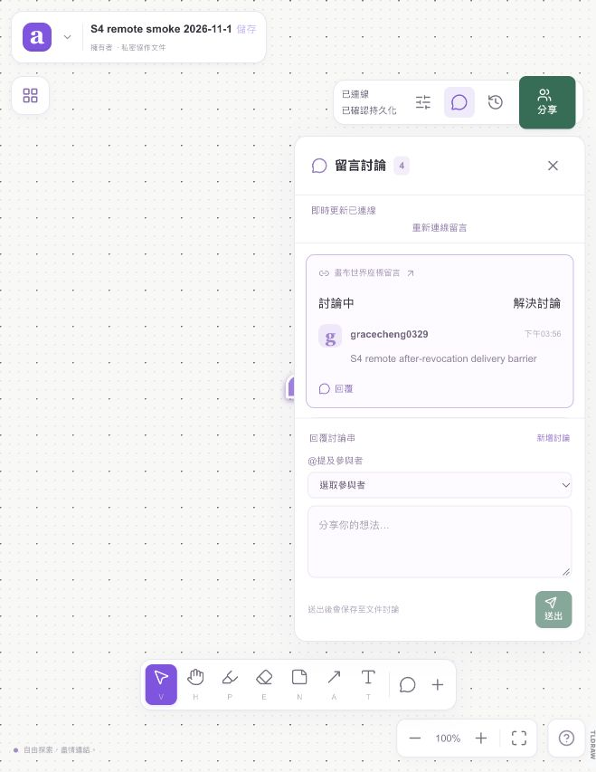
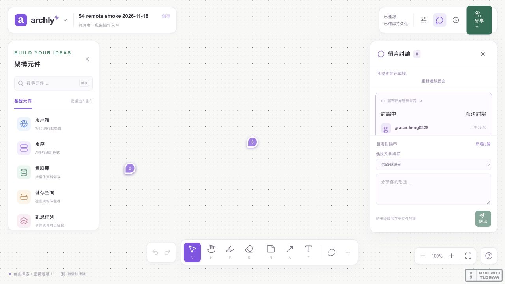
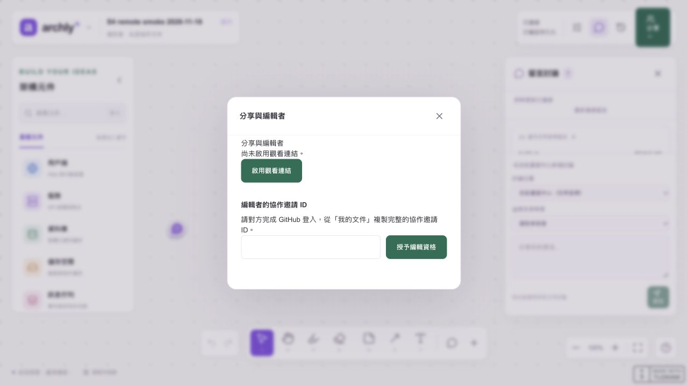

# S4 remote deployment verification

Updated: 2026-11-20 (Asia/Taipei). Target: `editor-s1-test` and the Vercel `editor` Production environment. The remote migration, Production JWT configuration, heartbeat fix deployment, and hosted recheck are complete for #13/#14.

## Remote migration

Target project `editor-s1-test` (`gnmaayjhlnrlqcpxkjjw`), Seoul (`ap-northeast-2`), Postgres `17.11.0.011`, was `ACTIVE_HEALTHY` when checked. Before applying changes, catalog inspection confirmed the original S1 tables and functions existed, no S4 tables or comment RPC existed, and migration history was empty because S1 had been applied manually. The public comment RPC returned `PGRST202` before migration.

Applied one recorded migration, `20261118073210_s4_comments_release_20261118`, containing the missing `202611090007`, `202611090008`, `202611110001`, and `202611170001`–`202611170004` source migrations. Existing S1 migrations were not rerun; existing documents were retained. Source checksums and post-migration catalog results are recorded in the [migration manifest](s4-remote-migrations.json).

Post-apply checks confirmed all three private comment tables have RLS, neither `anon` nor `authenticated` can select them directly, resolution metadata columns exist, controlled read/write/status RPCs exist, and the private `document_comment_broadcast` policy exists. The public protected comment RPC returned `401 / 42501` for an anonymous request instead of missing-function `404 / PGRST202`; the deployed product route returned `401 / UNAUTHENTICATED`. Security advisors reported informational/warning notices for deny-all private-table RLS and deliberately exposed, internally authorized definer RPCs; no broad table access was granted.

## JWT and first production deployment

The Supabase project uses an ECC P-256 current Auth signing key and retains a previous HS256 shared secret for verification. The app's existing HS256 document-ticket contract uses that retained project secret; no signing key was rotated or revoked. Vercel project `editor`, team `gracecheng0329s-projects`, has `SUPABASE_JWT_SECRET` as a Production-only Secret. It was updated from the same project's retained legacy key through the authenticated dashboards. The value stayed write-only, server-only, and out of repository/local environment files.

Vercel deployment `HKczMM4npBw7FuJDMH6CqEA5Qqms` was Ready in Production, created 2026-11-18 15:48:01 +08:00 from source commit `33f18a786fc1a0c4f30417bedfffd312ed5bb47c`. The formal domain `https://editor-gracecheng0329s-projects.vercel.app` (also shown as `editor-one-topaz.vercel.app`) served the app with the new Production environment.

Through the formal owner UI, a private smoke document `S4 remote smoke 2026-11-18` (`e992531e-2d13-4a4a-a350-c8c4ee584bca`) was created. Hosted UI checks verified discussion persistence after reload, stable self-mention identity, resolve/reopen, and a private Realtime Broadcast observed by an independent anonymous listener using the document ticket. Revoking a share link made subsequent protected reads return `403` and closed the already-joined viewer channel within the ticket lease; a delivery-barrier event sent after revocation was not delivered. Smoke entries are clearly prefixed `S4 remote` in this disposable test document. The temporary test share link was revoked after use.

## Production recheck of the Realtime heartbeat correction

An owner page diagnostic showed intermittent Realtime reconnect status. A real-service Playwright regression then isolated a delivery gap: Supabase JS invokes the configured `accessToken` callback on each heartbeat. Calling `realtime.setAuth(documentTicket)` alone was insufficient because the default callback in an anonymous client could subsequently replace it with the public API key. After a natural heartbeat, new discussion events could wait for the five-second reconciliation read.

The fix now supplies an `accessToken` callback backed by the current per-document ticket, updates it before `setAuth`, and clears it on deny or teardown. The regression test blocks reconciliation reads after the natural heartbeat, posts a new comment through the public API, and requires the event-driven read within 1.5 seconds. It failed before the fix and passed after it. The full local recovery suite passed all five tests in 2.3 minutes, covering the 45-second ticket lease, heartbeat delivery, failed-connection recovery and missed-message reads, revocation clearing, and delayed/duplicate notification ordering. TypeScript, scoped Biome, `git diff --check`, and the local Next.js production build passed on 2026-11-20.

Vercel Production deployment `DuUKvsydRsEEEiunNazFpHKCcwtg` reached Ready on 2026-11-20 at 13:58:29 +08:00 from exact source commit `16aa2fe04266541db1c3ffcb4b1c404a2628c7d9` on `codex/13-14-15`. The formal app domain served that deployment. On the owner UI, the test document loaded with the existing discussions; a new `S4 remote Production heartbeat callback smoke 16aa2fe` discussion was persisted. An independent anonymous viewer listener subscribed with its own document ticket and current-token callback. After the natural heartbeat window elapsed at about 34 seconds, the owner posted `S4 remote Production post-heartbeat delivery 16aa2fe`; the listener received the private Broadcast at about 46 seconds and its protected read returned `200` with seven threads. This verifies event delivery after the heartbeat without relying on the five-second reconciliation read.

The owner then revoked the temporary viewer link. The owner UI showed that the link was disabled. The listener's next protected read returned `403`, and its subscribed channel reported `CLOSED` in the same ten-second polling interval. Reloading the owner page retained all seven discussions, including the post-heartbeat entry, and showed both document sync and discussion Realtime connected. The temporary viewer capability remains revoked.

The same exact Production deployment was then used for a final #13 review smoke. The owner posted `S4 remote Production mention/review smoke 16aa2fe`, selected the current document participant for an @mention, and verified the rendered mention resolves to the stable participant identity. The owner resolved that discussion and reopened it. After reloading the document and reopening the discussion panel, all eight discussions remained persisted; the new mention thread remained open, and document sync plus discussion Realtime showed connected / confirmed-persisted status. This closes the exact-deployment hosted recheck for #13/#14.

The earlier hosted owner smoke on 2026-11-18 also verified stable self-mention identity and resolve/reopen on the formal UI. The exact heartbeat-fix deployment has now passed hosted persistence, post-heartbeat Broadcast, and revocation checks; #13/#14 no longer have a pending Production recheck.
